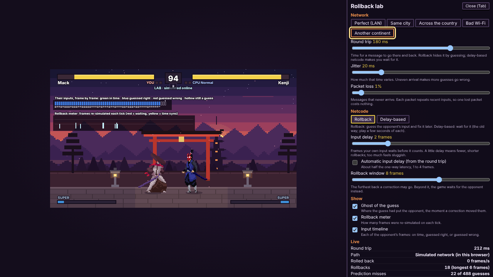
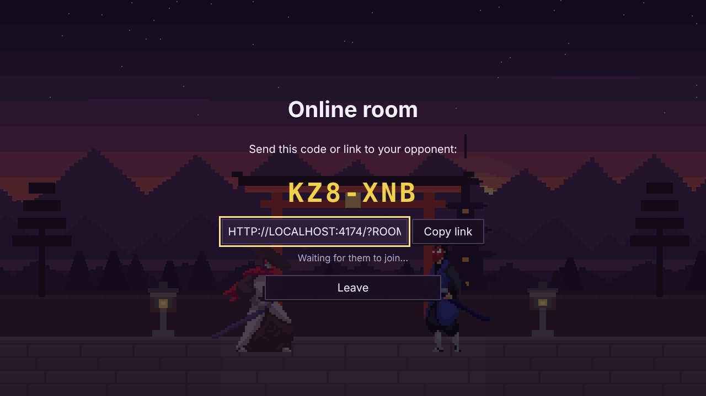
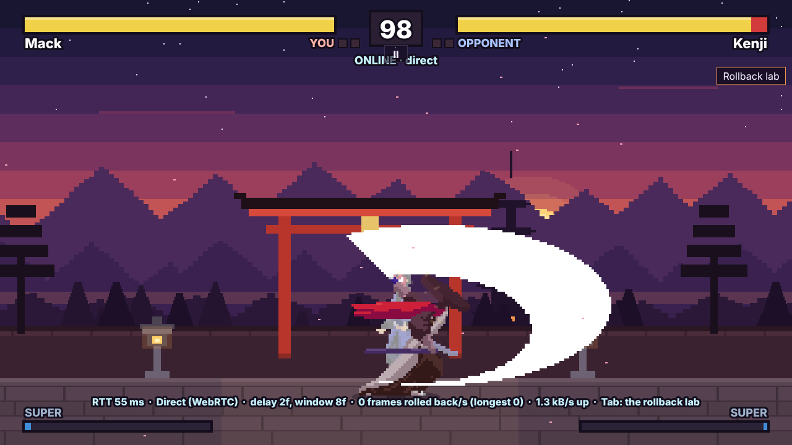
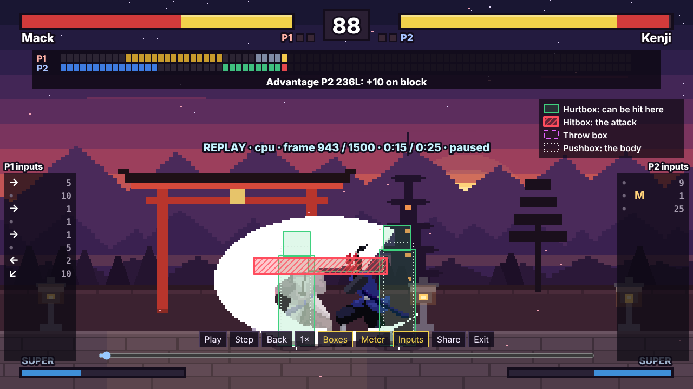
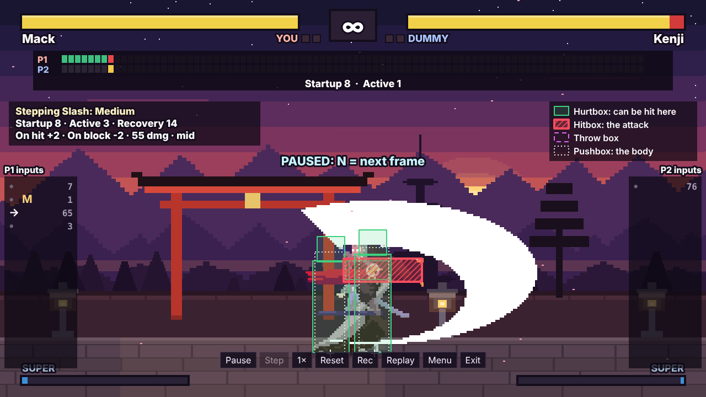
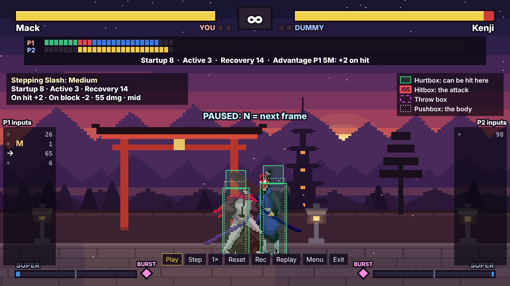
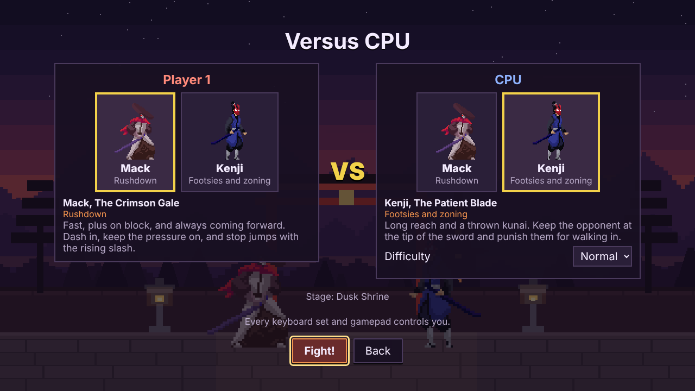
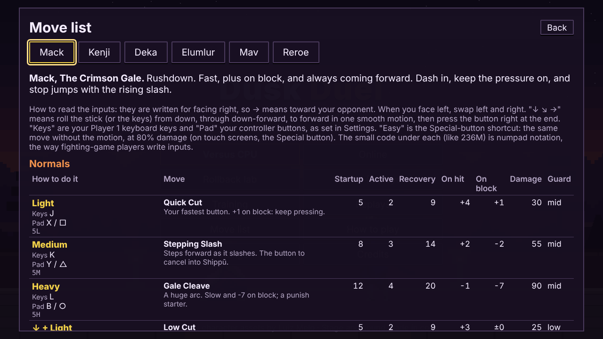

# Dusk Duel

A 2D fighting game in the browser with **rollback netcode**, built the way
fighting games are actually built:

- a **deterministic fixed-frame simulation**;
- moves defined as **frame data**, with per-frame hitboxes and hurtboxes;
- an **input buffer with motion inputs**;
- a real **training mode** that shows all of it.

Two samurai, a CPU opponent, local versus, **online play** (peer to peer
over WebRTC), **replays**, and touch controls for phones. It's plain
JavaScript on a canvas.

**Play it:** <https://rdbagwell.github.io/dusk-duel/>

## The rollback lab


**Try this first.** On the title screen, choose **Rollback lab → Start**.

- You fight the CPU, but the CPU's game is a *second copy of the game*
  running in your browser, connected to yours through a simulated network.
- It's the same rollback code an online match uses, so you can try it
  alone, offline.
- **Tab** opens the panel, where you can:
  - set the latency (0–250 ms), the jitter and the packet loss;
  - pick a preset: Same city, Across the country, Bad Wi-Fi or Another
    continent;
  - switch between **rollback** and the old **delay-based** netcode;
  - change the input delay (0–8, or automatic) and the rollback window.
- On screen, you'll see:
  - the **input timeline** (each of the opponent's frames: arrived in
    time, guessed right, or guessed wrong);
  - the **rollback meter**;
  - a **ghost** where the guess had the opponent;
  - live stats: round trip, rollback frames per second, the longest
    rollback, time-sync skips, bandwidth and the network path.



**[docs/ROLLBACK.md](docs/ROLLBACK.md) explains how it all works** in plain
language: prediction, rolling back, input delay, time sync, keeping sounds
from repeating, and catching desyncs. It has diagrams, links to the code,
measurements, and an honest comparison with
[Netcode Pong](https://github.com/RDBagwell/netcode-pong)'s
server-authoritative model.

The measured result in one line: on simulated Bad Wi-Fi (60 ms, ±60 ms
jitter, 8% loss), rollback with 2 frames of input delay never froze.
Delay-based netcode froze 32 times a second, and still 3.5 times a second
at 5 frames of delay ([how it was measured](docs/PERFORMANCE.md#rollback-netcode-session-2)).

## Online play

**Online → Create a private room** gives a room code and an invite link.

- **Quick match** pairs you with whoever else is waiting.
- Both players pick a character, a match, then a rematch or a new pick.
- If a player drops, the match pauses for 30 seconds while they
  reconnect; after that it's forfeited.

How it connects:
- The two browsers connect **directly** over a WebRTC data channel.
- If they can't (strict NATs, networks that block UDP), the inputs go
  through the server instead.
- The match shows which path it's on: "ONLINE · direct" or "ONLINE · relay".

The server is small ([`server/`](server/)): it pairs players, passes the
WebRTC setup messages, and relays inputs if needed. **It never runs the
game.** [SECURITY.md](SECURITY.md) explains what that means for trust.

| | |
| --- | --- |
|  |  |
| A private room: the code and the invite link | An online match, on the direct path (captured from two real browsers) |

## Replays

Every match is recorded: CPU, local versus, online and the lab.

- **Title → Replays** lists the last 12, which are kept in this browser
  only.
- The viewer can:
  - play, pause and frame-step (N, and B for back);
  - play at ½, ¼ or 2× speed;
  - seek to any frame;
  - turn on the training overlays (hitboxes, frame meter, input display).
- **Share** downloads the replay as a small text file, or copies a link
  for short matches.

A replay is just the starting options and both players' inputs, a few KB a
minute. The simulation is deterministic, so that reproduces the match
exactly. A loaded replay is validated like any untrusted input, and one
recorded with a different version of the game is refused.



## The training mode

Choose **Training mode**, walk up to the dummy and attack it. Then:

- the **hitbox overlay** shows where each attack can hit (red, hatched) and
  where each fighter can be hit (green), frame by frame;
- the **frame meter** lays both fighters' frames side by side (startup,
  active, recovery, stun) and *measures* the frame advantage of every
  exchange ("P1 5M: +2 on hit");
- the **frame data panel** gives the move's numbers; the **input display**
  shows what the game received and which motions it recognised;
- **P** pauses, **N** steps one frame, **T** slows to ½ and ¼ speed;
- the **dummy** can:
  - stand, crouch or jump;
  - block nothing, everything, or everything after the first hit;
  - escape throws;
  - **record and play back** whatever you make it do (O to record, Y to
    replay).

[docs/FRAME-DATA.md](docs/FRAME-DATA.md) explains frame data, hitboxes, the
input buffer, motion inputs, hitstun and advantage, with frame-by-frame
diagrams.

| | |
| --- | --- |
|  |  |
| Hitboxes and hurtboxes on the frame a hit lands | The frame meter and the measured advantage |
|  |  |
| Character select | The move list, generated from the same data the game runs on |

## How to play

| Action | Player 1 keys | Player 2 keys | Gamepad | Touch |
| --- | --- | --- | --- | --- |
| Move, jump, crouch | W A S D | Arrow keys | D-pad / left stick | Left thumb (the stick appears where you touch) |
| Light / Medium / Heavy | J / K / L | Num 1 / 2 / 3 (or , . /) | X / Y / B | L / M / H |
| Throw (L+M) | U | Num 4 (or ;) | A | Throw |
| Easy special | I | Num 5 (or ') | RB | Special |
| Pause | Esc | Esc | Menu / Options | II |

- **Blocking.** Hold back to block. Hold down-back to block lows; stand to
  block overheads and jump-ins.
- **Moving.** Tap forward twice to dash.
- **Specials** are in the move list (title screen or pause menu).
- **Who controls whom.** In single-player and online modes, every keyboard
  set and gamepad controls you. In local versus, player 1 has the left
  keys and the first gamepad, player 2 the right keys and the second.

**Settings** has:
- remappable keys and buttons;
- volume for sound effects and music;
- touch controls;
- **accessibility options**: reduced motion (no shake, flashes or petals),
  **captions for important sounds** (round start, K.O., throws, supers…),
  and **easy specials** (specials without the motions, at 80% damage).

The lab's overlays never rely on colour alone: wrong guesses are marked,
guesses not yet confirmed are hollow, and stalls are full height.

| | Mack, the Crimson Gale | Kenji, the Patient Blade |
| --- | --- | --- |
| Style | Rushdown: fast buttons, plus on block | Footsies and zoning: long reach, a thrown kunai |
| Specials | Shippū (236 + attack): a dashing slash. Tenkū (623 + attack): an invincible rising slash | Kunai (236 + attack). Iai Rush ([4]6 + attack): a charge dash-thrust |
| Super (full meter) | 236236 + H: a five-hit rush | 236236 + H: a crescent that crosses the screen |

## Architecture

```
            ┌───────────── each player's browser ──────────────┐
 keyboard,  │  input ──► RollbackSession ──► sim.step(state)   │
 gamepad,   │  (1 byte     │  predict, roll back,   │          │
 touch      │   a frame)   │  time sync, checksums  ▼          │
            │              │            events ──► sound, sparks│
            │              │            state  ──► renderer, HUD│
            └──────────────┼───────────────────────────────────┘
                           │ inputs only (~1.5 kB/s)
            WebRTC data channel (direct), or the server's relay
                           │
            ┌──────────────┴───────────────────┐
            │ matchmaking server (Node)        │  pairs players, signalling,
            │ never runs the game              │  relay fallback; no game state
            └──────────────────────────────────┘
```

- **[`src/engine/sim/`](src/engine/sim/): the deterministic simulation.**
  - `step(state, inputs)` runs at a fixed 60 frames a second.
  - The whole game is one plain, serialisable object (about 1.4 KB), using
    integer subpixel maths, with no clock and no `Math.random`.
  - `saveState`, `loadState` and `hashState` are what rollback, replays
    and desync detection are built on.
  - A golden-hash test catches any change to how a match plays out.
- **[`src/engine/rollback/`](src/engine/rollback/): the rollback netcode**,
  one small module per idea (session, packets, time sync, event
  presentation, desync tools, the simulated network). It knows nothing
  about the characters or the browser.
- **[`src/game/data/`](src/game/data/): combat as data.**
  - Every move's startup, active and recovery frames, its per-frame
    hitboxes and hurtboxes, damage, stun, pushback, cancels and
    invincibility, and which sprite frame shows on each simulation frame.
  - The tests **measure every move in the simulation**, to prove the
    published frame data is right.
- **[`src/game/`](src/game/): the game.** Scenes, the renderer, the HUD,
  the training tools, the CPU (which plays through inputs, with a human
  reaction delay), online play ([`online/`](src/game/online/)) and
  replays ([`replay/`](src/game/replay/)).
- **[`server/`](server/) and [`shared/protocol.js`](shared/protocol.js): the
  matchmaking server.** Express, Socket.io, helmet and zod, in the same
  structure as Netcode Pong and Chat Mafia.

[docs/ENGINE.md](docs/ENGINE.md) has the layout and the frame flow.

### Adding a move or a character, as data

**A move** is an entry in the character's `moves` in
[`src/game/data/characters/`](src/game/data/characters/), for example:

```js
'5L': {
  name: 'Quick Cut', kind: 'normal', notation: '5L', stance: 'stand', button: 'L',
  startup: 5, active: 2, recovery: 9,
  anim: [['attack1', 1, 2], ['attack1', 3, 2], ['attack1', 4, 2], ['attack1', 5, 4], ['attack1', 3, 5]],
  hits: [hit([5, 6], [[10, -80, 58, 18]], { damage: 30, hitstun: 14, blockstun: 11, hitstop: 8, push: 7 })],
  hurt: [{ frames: [5, 10], boxes: [[14, -78, 30, 14]] }],
  cancel: { on: 'contact', into: ['special', 'super', '5L', '2L'], frames: [5, 10] },
  description: 'Your fastest button. +1 on block: keep pressing.',
},
```

Then:
1. Run `npm test`. The data validator checks every sprite frame and box,
   and the frame-data tests measure the new move in the simulation.
2. Run `npm run framedata` to print the table for FRAME-DATA.md.
3. The move list and the training mode's frame data panel pick the move
   up from the data. For the CPU to use it, add it to the character's
   profile in [`cpu/profiles.js`](src/game/cpu/profiles.js), written as
   inputs in numpad notation.

**A character** is:
1. a data file like [`mack.js`](src/game/data/characters/mack.js);
2. an entry in [`characters/index.js`](src/game/data/characters/index.js);
3. its sprite sheets in `public/sprites/`, listed in [ASSETS.md](ASSETS.md);
4. a CPU profile in [`cpu/profiles.js`](src/game/cpu/profiles.js);
5. its id in `CHARACTERS` in [`shared/protocol.js`](shared/protocol.js), so
   the server accepts it online (a test checks this).

Any data change also changes the game version, so older replays are
refused instead of playing out differently.

## Then and now

The tag [`v1-original`](https://github.com/RDBagwell/Fighting-Game/tree/v1-original)
keeps the 2022 version.
- It was about 630 lines, following
  Chris Courses' "JavaScript Fighting Game" tutorial: two samurai, one attack box each, a timer and
  health bars.
- The rebuild kept the two characters' art and replaced everything else.
- The original's background and shop came from a pack whose licence
  forbids redistribution, so they were removed and replaced by a stage
  drawn in code. [ASSETS.md](ASSETS.md) explains this, with optional
  commands to purge them from the history.

<!-- TODO(Robert): a few sentences in your own words: what you learned from the tutorial in 2022, and what you wanted to find out by rebuilding it. -->

## Run it

You need [Node.js](https://nodejs.org/) 22.12 or newer.

```sh
npm install
npm run dev          # the game: open the printed http://localhost:5173 link
npm run dev:server   # the matchmaking server on http://localhost:3000 (for online play)
```

Everything except online play works without the server. For online play,
open the game in two browser tabs, create a room in one, and open the
invite link in the other.

| Command | What it does |
| --- | --- |
| `npm test` | Type check (`tsc --noEmit` over the JSDoc types), then all unit and integration tests (below) |
| `npm run build` | Production build in `dist/` (relative paths: works in any folder) |
| `npm run build:e2e` | The same build, pointed at a local server, in `dist-e2e/` |
| `npm run test:e2e` | Playwright tests in headless Chromium, against both builds and a local server (run the two builds first) |
| `npm run screenshots` | Regenerate `docs/screenshots/` |
| `npm run capture-media` | Regenerate `docs/media/` (the GIF needs `ffmpeg`) |
| `npm run bench` | Time a simulation step, saveState, loadState and hashState |
| `npm run netplay-stats` | Rollback frequency, cost and bandwidth under each network preset, and delay-based for comparison |
| `npm run load-test` | The matchmaking server's CPU and memory with N relayed matches |
| `npm run desync -- a.json [b.json]` | From a saved desync log: the first frame that differs, and what differs |
| `npm run framedata` | Every move's frame data as Markdown |
| `npm start` | The server in production mode |

### Tests

**`npm test`** runs 250 tests, in 16 files. The main ones:

- **Rollback** ([`tests/rollback.test.js`](tests/rollback.test.js)):
  - two sessions under every network preset, with late, reordered,
    duplicated and lost packets, end in exactly the state the same inputs
    give with no network;
  - every input delay from 0 to 8, and delay-based mode;
  - the rollback window stalls when exceeded;
  - time sync keeps a late or slow peer in step;
  - each real event's sound plays once;
  - a corrupted state is caught, on the exact frame.
- **The netplay harness** ([`tests/harness/`](tests/harness/)): the real
  server and two in-process clients, with a simulated network between each
  and the server. It plays a full match under Bad Wi-Fi with no desync,
  checks that the frame difference stays bounded, and exercises the relay
  path.
- **Server security** ([`tests/server/`](tests/server/)):
  - foreign origins are refused;
  - malformed and oversized messages are rejected;
  - rate limits work;
  - a forged token can't take a seat;
  - the quick-match queue never pairs a player with themselves or a dead
    socket.
- **Replays** ([`tests/replay.test.js`](tests/replay.test.js)):
  - a recorded match plays back to the identical state;
  - seeking equals playing straight through;
  - malformed and wrong-version replays are rejected.
- **Session 1's tests**: determinism (including the golden hash), motion
  inputs, frame data measured in the simulation, blocking, throws, combos,
  rounds, the CPU, the data validator and assets.

**`npm run test:e2e`** runs 11 Playwright tests:
- smoke tests;
- the lab;
- the replay viewer;
- captions;
- two real browsers playing online over a direct WebRTC connection, with
  matching checksums and the pause when one disconnects.

Measured numbers, and how to reproduce them, are in
[docs/PERFORMANCE.md](docs/PERFORMANCE.md):
- a simulation step costs about 4.5 µs;
- an 8-frame rollback with saving and hashing costs 0.23 ms;
- a player sends 1.2–1.9 kB/s;
- the server uses about 0.8% of a core per fully relayed match.

## Deploy

**The game: GitHub Pages.**
- `.github/workflows/pages.yml` type-checks and tests every push (Ubuntu and
  Windows), audits the dependencies, builds, runs the Playwright tests,
  and deploys `master` to GitHub Pages.
- One-time setup: **Settings → Pages → Source: GitHub Actions**.

**The server: Render's free tier**, from [`render.yaml`](render.yaml).
1. In Render, create a **Blueprint** from this repository.
2. When asked for `ALLOWED_ORIGINS`, enter `https://rdbagwell.github.io`
   (no path, no trailing slash).
3. When the service is live, copy its URL (e.g.
   `https://dusk-duel-server.onrender.com`). In GitHub, open **Settings →
   Secrets and variables → Actions → Variables**, add `GAME_SERVER_URL`
   with that URL, then re-run the Pages workflow.

The build puts that URL into the game and into the page's
Content-Security-Policy. Without it, everything but online play still
works.

A free Render service sleeps after 15 minutes without traffic. The first
visitor after that waits about a minute (the lobby says so).
[`.env.example`](.env.example) lists every setting.

## Privacy

- **No accounts and no tracking.** The game stores your settings and
  recent replays in your browser's local storage. Nothing is sent anywhere
  unless you play online.
- **Online play.**
  - The matchmaking server sees your IP address and your room. It keeps
    nothing once the room closes, and its own logs contain no IP addresses
    and no messages (Render, the host, keeps its usual request logs).
  - To connect you directly to your opponent, your browser asks a public
    **STUN server** (Google's `stun.l.google.com` or Cloudflare's
    `stun.cloudflare.com`) for your public IP address. Then your
    **opponent's browser learns your IP address**, as in any peer-to-peer
    game.
  - If a direct connection can't be made, your inputs go **through the
    matchmaking server** (the relay) instead.
- **Replays** stay on your device unless you download one or copy its link.

## What to look at (for reviewers)

1. **The lab** (title → Rollback lab), then
   [docs/ROLLBACK.md](docs/ROLLBACK.md).
2. **[`RollbackSession.js`](src/engine/rollback/RollbackSession.js)**,
   about 460 lines, with comments: the whole algorithm. Then
   [`tests/rollback.test.js`](tests/rollback.test.js) for how it's proven.
3. **Determinism**: [`src/engine/sim/`](src/engine/sim/) and
   [`tests/determinism.test.js`](tests/determinism.test.js). Rollback,
   replays and desync detection all depend on it.
4. **Frame data as data**:
   [`src/game/data/characters/`](src/game/data/characters/), the training
   mode, and [docs/FRAME-DATA.md](docs/FRAME-DATA.md).
5. **The server's security**: [SECURITY.md](SECURITY.md) (the P2P trust
   model), [`server/`](server/) and [`tests/server/`](tests/server/).
6. **Measurements**: [docs/PERFORMANCE.md](docs/PERFORMANCE.md). Every
   number comes with the command that produced it.

## Credits

- **Pixel art / character assets by Luiz Melo**: "Martial Hero" and
  "Martial Hero 2" (CC0), <https://luizmelo.itch.io/>. The licence doesn't
  require credit; it's given with thanks.
- **Game, engine, netcode, stage and synthesised sound:** Robert Bagwell,
  with Claude.
- **Music:** Robert's own, when added ([docs/AUDIO.md](docs/AUDIO.md)).
- The 2022 version followed Chris Courses' "JavaScript Fighting Game"
  tutorial.
- Rollback netcode as an idea is Tony Cannon's GGPO. The approach here
  follows its published design: prediction by repeating inputs, a
  rollback window, frame advantage for time sync.

[ASSETS.md](ASSETS.md) lists every file, its source and its licence.
