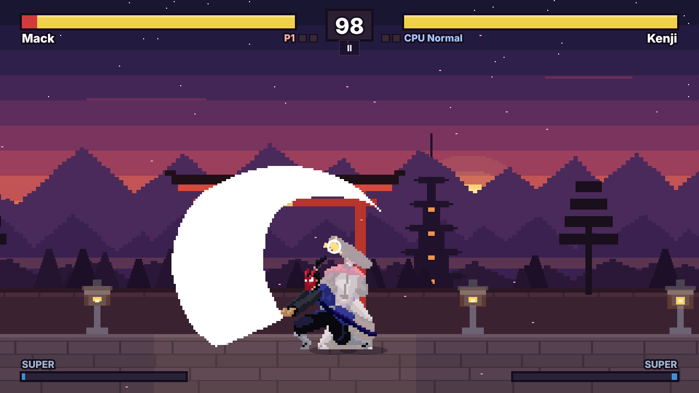
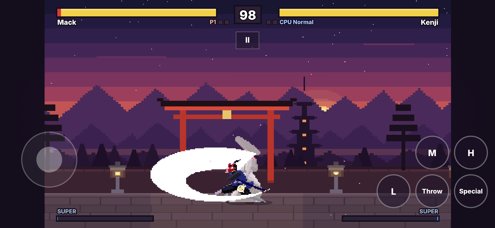

# Dusk Duel

A small 2D fighting game in the browser, built the way fighting games are
actually built: a **deterministic fixed-frame simulation**, moves defined as
**frame data** with per-frame hitboxes and hurtboxes, an **input buffer with
motion inputs**, and a real **training mode** that shows all of it. Two
samurai, a CPU opponent with three difficulties, local versus, and touch
controls for phones. Plain JavaScript on a canvas, no runtime dependencies.

**Play it:** <https://rdbagwell.github.io/Fighting-Game/>


| | |
| --- | --- |
|  |  |
| A CPU match, on the frame a hit lands | The frame meter: startup, active, recovery, hitstun, and the measured advantage |
|  |  |
| Character select | The move list, generated from the same data the game runs on |

On a phone, held sideways: 

## The training mode

**Start here if you're looking at this as a portfolio piece.** Choose
**Training mode**, walk up to the dummy and attack it. Then:

- the **hitbox overlay** shows where each attack can hit (red, hatched) and
  where each fighter can be hit (green), frame by frame;
- the **frame meter** lays both fighters' frames side by side (startup,
  active, recovery, stun) and *measures* the frame advantage of every
  exchange ("P1 5M: +2 on hit");
- the **frame data panel** gives the move's numbers; the **input display**
  shows what the game received and which motions it recognised;
- **P** pauses, **N** steps one frame, **T** slows to ½ and ¼ speed;
- the dummy can stand, crouch or jump, block nothing, everything, or
  everything after the first hit, escape throws, and **record and play
  back** whatever you make it do (O to record, Y to replay).

Every feature has a one-line "What this shows" in the training menu (Tab).
[docs/FRAME-DATA.md](docs/FRAME-DATA.md) explains frame data, hitboxes, the
input buffer, motion inputs, hitstun and advantage, and why the simulation
must be deterministic, with frame-by-frame diagrams.

## The engine

- **Deterministic simulation** ([src/engine/sim/](src/engine/sim/)):
  `step(state, inputs)` at a fixed 60 frames a second; the whole game is one
  plain, serialisable object; integer subpixel maths; a seeded RNG in the
  state; no clock or `Math.random`. `saveState` / `loadState` / `hashState`
  are tested to resume identically, which is what session 2's **rollback
  netcode** needs. One step costs about 4.5 µs and an 8-frame rollback under
  0.1 ms ([docs/PERFORMANCE.md](docs/PERFORMANCE.md)).
- **Combat as data** ([src/game/data/characters/](src/game/data/characters/)):
  every move's startup, active and recovery, per-frame hitboxes and
  hurtboxes, damage, chip, hitstun, blockstun, pushback, launch, cancels,
  invincibility, and which sprite frame shows on each simulation frame.
  Frame advantage is derived from that data, and the tests **measure every
  move in the simulation** to prove the published numbers are right.
- **The fundamentals:** walking, dashing, jumping, crouching; blocking by
  holding back (lows, overheads, cross-ups); throws and throw escapes;
  hit-stop, pushback and the corner; cancels, damage scaling and a juggle
  limit; best of three with a timer, knockdowns and invincible wake-ups.
- **Input:** keyboard, gamepads (standard mapping) and touch, for two local
  players, remappable; one byte per player per frame; a 4-frame buffer and
  motion inputs (236, 623, [4]6, 236236) with leniency windows defined in
  data.
- **A CPU that plays through inputs only**: it reads the state with a
  human reaction delay and returns a controller byte, like a player.

[docs/ENGINE.md](docs/ENGINE.md) has the layout, the frame flow, and where
rollback, replays and online play plug in.

## The fighters

| | Mack, the Crimson Gale | Kenji, the Patient Blade |
| --- | --- | --- |
| Style | Rushdown: fast buttons, plus on block | Footsies and zoning: long reach, a thrown kunai |
| Specials | Shippū (236 + attack): a dashing slash. Tenkū (623 + attack): an invincible rising slash | Kunai (236 + attack). Iai Rush ([4]6 + attack): a charge dash-thrust |
| Super (full meter) | 236236 + H: a five-hit rush | 236236 + H: a crescent that crosses the screen |

## How to play

| Action | Player 1 keys | Player 2 keys | Gamepad | Touch |
| --- | --- | --- | --- | --- |
| Move, jump, crouch | W A S D | Arrow keys | D-pad / left stick | Left thumb (the stick appears where you touch) |
| Light / Medium / Heavy | J / K / L | Num 1 / 2 / 3 (or , . /) | X / Y / B | L / M / H |
| Throw (L+M) | U | Num 4 (or ;) | A | Throw |
| Easy special | I | Num 5 (or ') | RB | Special |
| Pause | Esc | Esc | Menu / Options | II |

Block by holding back; hold down-back to block lows, stand to block
overheads and jump-ins. Tap forward twice to dash. Specials are in the move
list (title screen or pause menu). In single-player modes every keyboard set
and gamepad controls you; in local versus, player 1 has the left keys and
the first gamepad, player 2 the right keys and the second (Settings can
swap the pads). Keys and buttons can be remapped in **Settings**, which also
has volume, reduced motion (no shake, flashes or petals), touch controls and
"easy specials" (specials without the motions, at 80% damage).

## Then and now

The tag [`v1-original`](https://github.com/RDBagwell/Fighting-Game/tree/v1-original)
keeps the 2022 version: about 630 lines following Chris Courses'
"JavaScript Fighting Game" tutorial, with two samurai, one attack box each,
a timer and health bars. The rebuild kept the two characters' art and
replaced everything else. Its background and shop came from a pack whose
licence forbids redistribution, so they were removed and replaced by a
stage drawn in code ([ASSETS.md](ASSETS.md) explains, with optional commands
to purge them from the history).

## Run it

You need [Node.js](https://nodejs.org/) 20.19 or newer.

```sh
npm install
npm run dev          # open the printed http://localhost:5173 link
```

| Command | What it does |
| --- | --- |
| `npm run dev` | Development server with live reload |
| `npm test` | Type check (`tsc --noEmit` over the JSDoc types), then the unit tests: determinism, motion inputs, frame data measured in the simulation, blocking, throws, combos, rounds, the CPU, the data validator, assets |
| `npm run build` | Production build in `dist/` (relative paths: works in any folder) |
| `npm run preview` | Serve the last build |
| `npm run test:e2e` | Playwright smoke tests against the build (run `npm run build` first) |
| `npm run screenshots` | Regenerate `docs/screenshots/` (after `npm run build`) |
| `npm run bench` | Time a simulation step, saveState and loadState (`node tools/bench.mjs --browser` adds headless Chromium) |
| `npm run framedata` | Print every move's frame data as Markdown |

## Put it online (GitHub Pages)

`.github/workflows/pages.yml` type-checks and tests every push (Ubuntu and
Windows), builds, runs the smoke tests, and deploys `master` to GitHub
Pages. One-time setup: **Settings → Pages → Build and deployment → Source:
GitHub Actions**. The build uses relative paths, so renaming the repository
only changes the address: update `repo` in `site.config.js` and the link at
the top of this file (a test checks they agree).

## Project structure

```
index.html            page shell
site.config.js        where it's published (repository name, base path)
src/
  main.js             loads the art and starts the App
  engine/             reusable: sim (state, step, motion, boxes, frame data), loop, input, render, audio, assets
  game/
    data/             characters (moves, frame data, boxes), motions, rules, stages, credits
    scenes/           title, character select, VS, match, results, menus
    training/         dummy, frame meter, input display, overlays
    cpu/              the CPU opponent and its per-character profiles
    render/, hud/, stage/   fight renderer and effects, HUD, the Dusk Shrine
public/               sprite sheets and favicon (listed in ASSETS.md)
tools/                benchmark, frame data tables
tests/                Vitest unit tests; tests/e2e/ Playwright smoke tests and screenshots
docs/                 FRAME-DATA, ENGINE, PERFORMANCE, screenshots
```

Dependencies: none at runtime. Vite, Vitest, TypeScript (type checking only)
and Playwright for development, all pinned.

## Credits

- **Pixel art / character assets by Luiz Melo**: "Martial Hero" and
  "Martial Hero 2" (CC0), <https://luizmelo.itch.io/>. Credit isn't
  required by the licence; it's given with thanks.
- **Game, engine, stage, synthesised sound:** Robert Bagwell, with Claude.
- The 2022 version followed Chris Courses' "JavaScript Fighting Game"
  tutorial.

[ASSETS.md](ASSETS.md) lists every file, its source and its licence.
