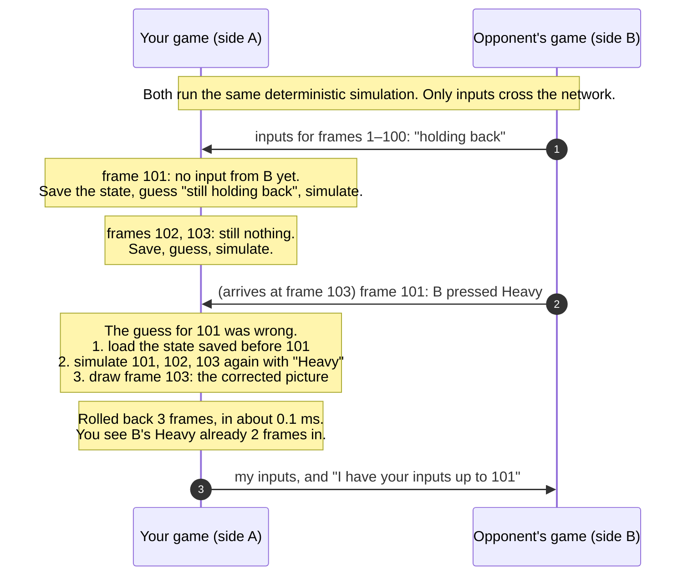

# Rollback netcode, explained

Dusk Duel's online play uses **rollback netcode**, the approach most modern
fighting games use (it was popularised by GGPO in 2006). This page explains it in plain language,
using the real code. You can watch every part of it happen, alone and
offline, in the **Rollback lab** on the title screen.

- [Why fighting games are hard to put online](#why-fighting-games-are-hard-to-put-online)
- [The idea in one paragraph](#the-idea-in-one-paragraph)
- [A rollback, frame by frame](#a-rollback-frame-by-frame)
- [The parts](#the-parts): [input exchange](#1-input-exchange), [prediction](#2-prediction), [rollback](#3-rolling-back), [input delay](#4-input-delay), [the rollback window](#5-the-rollback-window), [time sync](#6-time-sync), [events vs presentation](#7-events-vs-presentation), [desync detection](#8-desync-detection)
- [The connection](#the-connection-webrtc-with-a-relay-fallback)
- [Measured](#measured)
- [Compared with Netcode Pong](#compared-with-netcode-pong-server-authoritative)
- [Trade-offs and limits](#trade-offs-and-limits)
- [Where to read the code](#where-to-read-the-code)
- [Try it in the lab](#try-it-in-the-lab)

## Why fighting games are hard to put online

A fighting game runs at 60 frames a second, and the players care about single frames.
A jab that starts in 5 frames beats one that starts in 6. A combo only works if the next button lands
inside a window 2 or 3 frames wide. You can see this in [FRAME-DATA.md](FRAME-DATA.md).

So the obvious online design, where you **wait for the other player's input
before you simulate each frame**, has two problems:

1. **The delay.** If their input takes 60 ms to arrive, every press of
   yours has to be delayed by those same 60 ms (about 4 frames), so both
   sides see it on the same frame. Every move feels 4 frames slower. Worse,
   the delay changes with the connection, so a combo you can do offline
   won't work online.
2. **The stutter.** When a packet is late, the game freezes until it
   arrives. On Wi-Fi, that happens many times a second.

This is **delay-based netcode**, and for years it was the norm. The lab has
it as an option, so you can feel the difference.

## The idea in one paragraph

Don't wait. Each machine runs the whole game itself. When the opponent's
input for a frame hasn't arrived yet, **guess** it: assume they're still
doing what they were last doing (holding the same direction, the same
buttons). Most of the time that's right, because people hold inputs for
many frames. When the real input arrives and the guess was wrong, **roll
back**: load the saved state from just before the wrong frame, simulate
every frame since then again with the right input, and carry on. That
happens inside a single display frame, so you only ever see the corrected
result. Your own inputs are never delayed by the network, and the game
never freezes for a late packet.

The cost: when a guess was wrong, the opponent's character can jump a
little on your screen as the correction comes in. The lab draws a magenta
**ghost** where the guess had them, so you can see these corrections
happen.

## A rollback, frame by frame



The test that matters is the one that checks this is exact. Under every network
preset (late, reordered, duplicated and dropped packets), both sides end
up with **exactly** the same state, bit for bit, as the same inputs played
with no network at all
([`tests/rollback.test.js`](../tests/rollback.test.js)). This only works
because the simulation is deterministic: integers only, no `Math.random`,
and no dependence on time ([ENGINE.md](ENGINE.md)).

## The parts

The rollback code is one small module per idea, in
[`src/engine/rollback/`](../src/engine/rollback/). None of it knows about
the game's characters or the browser. It's handed a simulation, a state and
a transport.

### 1. Input exchange

[`packets.js`](../src/engine/rollback/packets.js)

An input is one byte per frame: a bit each for up, down, left, right and
the four buttons. Every tick, each side sends one small binary packet:

```
INPUT  type | frame | ack | advantage | start | count | input bytes × count
```

- **Redundancy.** A packet doesn't carry only the newest input. It carries
  *every* input the peer hasn't acknowledged yet (up to 64). So when a
  packet is lost, the next one carries the same inputs again, and nothing
  has to be re-sent.
- **Acks.** `ack` says "I have all your inputs up to this frame", so the
  sender can stop repeating them. On a healthy connection a packet carries
  2–5 inputs, about 20 bytes.
- **Safe to lose, duplicate or reorder.** Each packet makes sense on its
  own, so the connection can be *unordered with no retransmits*, like UDP.
  TCP would hold every later packet back behind a lost one, which defeats
  the purpose.
- **Hostile until proven otherwise.** `decode` checks every length and
  field. A malformed packet is dropped, never trusted.

### 2. Prediction

[`RollbackSession.predict`](../src/engine/rollback/RollbackSession.js)

The guess is the simplest one possible: **the opponent's last confirmed
input, repeated**. It's the GGPO default, and it's hard to beat. People
hold a direction for dozens of frames, and a guess that's wrong costs
only a short rollback. The lab's input timeline shows each of the
opponent's frames: arrived in time (green), guessed right (blue) or
guessed wrong (red, with a bar). In the measured runs below, 5–7% of guesses
were wrong, even with two Hard CPUs pressing buttons constantly.

### 3. Rolling back

[`RollbackSession.simulateNext`, `rollback`](../src/engine/rollback/RollbackSession.js)

- Before simulating each frame, the session **saves the state**. A state is
  about 1.4 KB of plain numbers, and saving one takes about 9 µs.
- It records which remote input it *used* for each frame. When the real
  input arrives, it's compared with that. If they differ, the frame is
  marked as the earliest wrong frame (`rollbackFrom`).
- At the start of the next tick, the session loads the state saved before
  that frame and re-simulates up to the present, within the tick. The
  renderer only ever sees the final state.

An 8-frame rollback (load plus 8 steps, saving and hashing each) has a
median cost of **0.23 ms**, about 1.4% of a 16.7 ms frame
(see [Measured](#measured)).

### 4. Input delay

[`RollbackSession.scheduleLocal`](../src/engine/rollback/RollbackSession.js)

Rollback and delay aren't either/or. Delaying your own input by a frame or
two gives it a head start on the network: it arrives at the other side
sooner relative to when it's needed, so there's less guessing and rollbacks
are shorter. Two frames (33 ms) is hard to feel, and it removes most short
rollbacks. That's why it's the default.

**Auto** sets the delay from the measured round trip, at about half the
one-way latency in frames, between 1 and 4
([`autoInputDelay`](../src/game/online/labOverlay.js)). The rest is left to
rollback.

### 5. The rollback window

The session will roll back at most **8 frames** (133 ms). If the opponent
is further behind than that, the session waits for them instead (a
**stall**, drawn as a red bar on the rollback meter).

Why have a limit at all:

- **Cost.** Each rollback frame costs simulation time. 8 frames is cheap
  here (0.23 ms), but there has to be a ceiling.
- **Memory.** Only the last 8 states need to be kept.
- **Sanity.** Corrections bigger than 133 ms look like teleporting. Waiting
  briefly is better than showing that.

In the measured runs, nothing stalled on any preset, even "Another
continent" (180 ms round trip), where the longest rollback was 6 frames.

### 6. Time sync

[`TimeSync.js`](../src/engine/rollback/TimeSync.js)

If one machine started a moment later, or its clock runs slightly slow, it
is always a little behind. Then the machine that's ahead does all the
guessing and all the rolling back, every frame, while the other never has
to. And the gap can grow until it hits the rollback window.

The fix, from GGPO:

- Each side estimates its **frame advantage**: its frame, minus (the peer's
  last reported frame plus the one-way latency in frames).
- Each side sends this estimate in every input packet.
- The side that's further ahead **skips a frame** (simulates nothing for
  one tick, shown in yellow on the meter), at most once every 20 frames.

Skipping one frame is invisible. Tests run a peer that starts 30 frames
late, and one whose clock runs 2% slow
([`rollback.test.js`](../tests/rollback.test.js), "time sync"), and check
that the difference between the two sides stays bounded. The netplay
harness checks the same thing through the real server.

### 7. Events vs presentation

[`EventPresenter.js`](../src/engine/rollback/EventPresenter.js)

The simulation reports what happened each frame: a hit, a block, a KO.
Sounds, sparks and screen shake are driven from those events. But rollback
re-simulates frames, and a re-simulated hit reports itself again. Played
naively, every hit would sound twice.

The presenter remembers what it has already presented in the last few
dozen frames. It presents an event only if no matching event (same type,
same side, same move) was presented within 2 frames of it. A correction
often moves a hit by a frame, and that still counts as the same hit. A hit
that only exists after a correction (one the guess missed) is presented
late, once.

A test plays a match under Bad Wi-Fi, where rollbacks are frequent, and
checks that each real event is presented exactly once.

What it can't do is take back a sound for a hit that a correction removed.
Every rollback game has this problem, and the input delay keeps it rare.

### 8. Desync detection

[`RollbackSession.checksums`](../src/engine/rollback/RollbackSession.js),
[`desync.js`](../src/engine/rollback/desync.js),
[`tools/desync.mjs`](../tools/desync.mjs)

If the two simulations ever disagree, the game is silently broken: each
player sees a different match. That would be caused by a bug, a browser
difference, or a tampered client. So the sessions check:

- Each side hashes the state of every confirmed frame (FNV-1a over the
  whole state).
- Every 30th frame's hash is sent to the peer.
- If the hashes differ, the match shows a notice and offers **"Save desync
  log"**. The log holds the options, both players' confirmed inputs and the
  per-frame hashes.

From the log, `npm run desync -- log.json` replays the inputs and reports
the **first frame where the recorded hash and the replayed one differ**,
and which fields of the state differ. Given both players' logs, it reports
the first frame where they diverge.

A test deliberately corrupts one side's state in the middle of a match
and checks that the exact frame is reported.

## The connection: WebRTC with a relay fallback

[`PeerLink.js`](../src/game/online/PeerLink.js),
[`server/`](../server/)

The two browsers talk **directly**, over a WebRTC data channel set to
`ordered: false, maxRetransmits: 0` (UDP-like, as above).

The server's job is small:

- **Matchmaking.** Private rooms with invite links, a quick-match queue,
  character select and rematches.
- **Signalling.** It passes the WebRTC offer, answer and ICE candidates
  between the two browsers, so they can find each other.
- **Relay.** Sometimes a direct connection can't be made, for example
  between two strict NATs, or on a network that blocks UDP. Then the same
  packets go through the server over the WebSocket instead. The match shows
  which path it's on ("ONLINE · direct" or "ONLINE · relay").

**The server never runs the game.** It never sees or decides any game
state. It doesn't know who is winning, and it forwards input packets
without reading them. To find a direct route, the browsers use public STUN
servers (Google's and Cloudflare's); see the README's privacy note.

The relay path is the one the automated harness tests. Node has no WebRTC,
so the harness puts two in-process clients on the real server, with a
simulated Bad Wi-Fi network between each client and the server, and plays
a full match ([`tests/harness/`](../tests/harness/)). The direct path is
tested in two real Chromium browsers
([`tests/e2e/online.spec.js`](../tests/e2e/online.spec.js)).

## Measured

Two real `RollbackSession`s, in one process, through the lab's simulated
network on a virtual 60 Hz clock. Each preset ran 3 one-minute matches of
Hard CPU against Hard CPU, with input delay 2 and rollback window 8.

```
npm run netplay-stats
```

Machine: Intel Xeon @ 2.80 GHz (4 threads), 16 GB, Linux, Node 22.22.0.
Rates are per player per second.

| Network | Round trip / jitter / loss | Rollbacks/s | Frames re-simulated/s | Longest | Guesses wrong | Stalls/s | Sent per player | Desyncs |
|---|---|---|---|---|---|---|---|---|
| Perfect (LAN) | 0 / 0 / 0% | 0.0 | 0.0 | 0 | 0.0% | 0.0 | 1.20 kB/s | none |
| Same city | 20 / 4 / 0% | 0.0 | 0.0 | 0 | 0.0% | 0.0 | 1.26 kB/s | none |
| Across the country | 80 / 10 / 0.5% | 3.4 | 3.4 | 2 | 5.6% | 0.0 | 1.50 kB/s | none |
| Bad Wi-Fi | 60 / 60 / 8% | 2.5 | 5.4 | 5 | 6.6% | 0.0 | 1.61 kB/s | none |
| Another continent | 180 / 20 / 1% | 3.0 | 13.6 | 6 | 6.2% | 0.0 | 1.91 kB/s | none |

How to read it:

- **No rollbacks in "Same city".** The 2-frame input delay (33 ms) covers
  the whole 10 ms one-way trip.
- **"Another continent" rolls back about as often as "Across the
  country"**, but each rollback is longer, because a wrong guess is found
  out later.
- **About 84 packets a second** go each way: 60 input packets, plus pings
  and checksums.
- **"Desyncs: none"** means two things. No checksum ever disagreed, and
  every confirmed frame's hash matched the same inputs simulated with no
  network.

The same networks with **delay-based** netcode (same command):

| Network | Rollback: stalls/s | Delay-based at 2 frames: stalls/s | Delay needed to rarely stall | Delay-based at that delay: stalls/s |
|---|---|---|---|---|
| Across the country | 0.0 | 20.2 | 3 frames (50 ms) | 0.6 |
| Bad Wi-Fi | 0.0 | 32.2 | 5 frames (83 ms) | 3.5 |
| Another continent | 0.0 | 41.8 | 7 frames (117 ms) | 0.7 |

That's the whole case for rollback, in one table:

- With the same 2-frame delay, delay-based netcode freezes 20–40 times a
  second.
- To stop freezing, it needs 3–7 frames of delay on every input, and on
  Wi-Fi it still freezes 3.5 times a second.
- Rollback, with 2 frames of delay, didn't freeze once.

Cost: **median 0.23 ms** for an 8-frame rollback, saving and hashing each
frame, which is about 1.4% of a frame.
- The worst single tick measured across these runs was 3.0 ms. That's an
  outlier during JIT warm-up, still well inside the 16.7 ms frame.
- [PERFORMANCE.md](PERFORMANCE.md) has the per-operation costs and the
  server load test.

## Compared with Netcode Pong (server-authoritative)

Robert's [Netcode Pong](https://github.com/RDBagwell/netcode-pong) uses
the other classic model: [**the server runs the only game that
counts**](https://github.com/RDBagwell/netcode-pong/blob/master/docs/NETCODE.md).
Clients send inputs, the server simulates, and it sends snapshots back.
Clients predict their own paddle and reconcile it with the snapshots, and
they interpolate everything else a little in the past.

| | Netcode Pong: server-authoritative | Dusk Duel: rollback, peer to peer |
|---|---|---|
| Who runs the game | The server | Both players, identically |
| What crosses the network | Inputs up, snapshots of the whole state down (20 a second) | Inputs only, both ways |
| Your own inputs | Predicted locally, corrected by the server | Applied locally after a fixed 2-frame delay |
| The opponent | Drawn ~100 ms in the past (interpolated) | Drawn in the present, guessed, corrected by rollback |
| When a guess is wrong | Your paddle is reconciled to the server's | The opponent is snapped to where they really are (the ghost) |
| Cheating | The server decides everything, so a modified client can't change the result | Each side trusts the other's inputs; a modified client can't change state the other side simulates, but nothing referees the result (see [SECURITY.md](../SECURITY.md)) |
| Server cost | Runs every match (CPU per room) | Pairs players and relays signalling; relays inputs only when a direct path fails |
| Players | Any number | Two, and each extra player multiplies the rollbacks |
| Needs | Shared simulation code, to predict | A fully deterministic simulation: one bit of difference is a desync |
| Best for | Many players, hidden information, a referee | Two players where single frames matter |

**Why fighting games chose rollback.** The deciding factor is timing.

- In Pong, seeing the other paddle 100 ms in the past is fine, because
  you're hitting the ball, not the paddle.
- In a fighting game, you're reacting to the opponent's move itself, and
  a jump-in seen 100 ms late is a jump-in you can't anti-air. Rollback is
  the only model that shows both players the present, with their own
  inputs at a constant, small delay.

What made it possible is the size of the state. A fighting game's whole
state is two fighters and a few projectiles, here about 1.4 KB. Saving
every frame and re-simulating 8 of them costs a fraction of a millisecond.

The server-authoritative model wins on fairness, because there's a
referee, and on scale, because there can be any number of players. That's
why shooters, MMOs and Pong-with-a-leaderboard use it.

## Trade-offs and limits

**Things you can see:**

- **Visual corrections.** A wrong guess makes the opponent jump on your
  screen, usually by a few pixels. The ghost overlay shows this. Bigger
  input delay means fewer corrections but less responsive controls. The
  lab lets you feel both.
- **Sounds can't be taken back.** A sound for a hit that a correction
  removed has already played (see [section 7](#7-events-vs-presentation)).

**Limits of the design:**

- **Determinism is a hard requirement.** Every rule is integer-only, and a
  test pins the final state hash of a recorded match (a golden value). Adding
  a `Math.random()` or a float anywhere in the simulation would break
  online play. That would show as a desync, never silently.
- **Two players only.** Spectators would need their own input feed, which
  isn't built.
- **There is no referee.** The trust model is in
  [SECURITY.md](../SECURITY.md).
- **Prediction is "repeat the last input".** Smarter guesses exist (for
  example, "they'll release the button they just pressed"), but GGPO's
  experience is that they rarely beat the simple one.

## Where to read the code

| What | File |
|---|---|
| The session: tick, prediction, rollback, stalls, checksums | [`src/engine/rollback/RollbackSession.js`](../src/engine/rollback/RollbackSession.js) |
| Packets | [`src/engine/rollback/packets.js`](../src/engine/rollback/packets.js) |
| Time sync | [`src/engine/rollback/TimeSync.js`](../src/engine/rollback/TimeSync.js) |
| Events vs presentation | [`src/engine/rollback/EventPresenter.js`](../src/engine/rollback/EventPresenter.js) |
| Desync tools | [`src/engine/rollback/desync.js`](../src/engine/rollback/desync.js), [`tools/desync.mjs`](../tools/desync.mjs) |
| Simulated network (lab and tests) | [`src/engine/rollback/NetworkSimulator.js`](../src/engine/rollback/NetworkSimulator.js), [`transport.js`](../src/engine/rollback/transport.js), [`presets.js`](../src/engine/rollback/presets.js) |
| WebRTC and the relay fallback | [`src/game/online/PeerLink.js`](../src/game/online/PeerLink.js) |
| The lab: panel, meter, timeline, ghost | [`src/game/online/LabPanel.js`](../src/game/online/LabPanel.js), [`labOverlay.js`](../src/game/online/labOverlay.js), [`src/game/scenes/netplay.js`](../src/game/scenes/netplay.js) |
| Server: rooms, queue, signalling, relay | [`server/`](../server/), [`shared/protocol.js`](../shared/protocol.js) |
| Tests | [`tests/rollback.test.js`](../tests/rollback.test.js), [`tests/harness/`](../tests/harness/), [`tests/server/`](../tests/server/), [`tests/e2e/online.spec.js`](../tests/e2e/online.spec.js) |

## Try it in the lab

**Title → Rollback lab → Start.** You fight the CPU, but the CPU's game is
a second copy of the game running in your browser, connected to yours
through a simulated network. It's the same rollback code an online match
uses. Press **Tab** to open or close the panel.

1. **Same city.** Nothing visible happens. The input timeline is all green
   and the meter is flat.
2. **Another continent.** Blue cells appear: guesses that turned out right.
   Every so often a red one (a wrong guess) and a bar on the meter: a
   rollback. Watch for the magenta ghost when the CPU starts an attack.
3. **Delay-based**, same network. The game freezes (red bars) many times
   a second. Raise the input delay to 7 to stop it, then try to do a combo.
4. Back to **Rollback**, and set the **Rollback window** to 2. Now the long
   corrections are refused and the session stalls instead. That's the
   trade-off the window makes.
5. **Bad Wi-Fi** with **Auto** input delay. This is what most online
   matches really look like.
